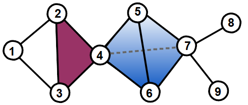

<div align="center">


# Functional Geometry of Protein-Protein Interaction Networks

**Noël Malod-Dognin and Nataša Pržulj**

Corresponding author: Prof. N. Pržulj, natasa.przulj@mbzuai.ac.ae



</div>

## Downloads

- [Dataset 1: higher-order interactome simplicial complexes](https://github.com/przulj-lab/simplets/releases/download/v1.0/Datasets_Interactomes.7z)
- [Dataset 2: real-world simplicial complexes](https://github.com/przulj-lab/simplets/releases/download/v1.0/Datasets_Real.7z)
- [Dataset 3: random model simplicial complexes](https://github.com/przulj-lab/simplets/releases/download/v1.0/Datasets_Models.7z)
- [Simplet counter](https://github.com/przulj-lab/simplets/releases/download/v1.0/Counter.7z)

The datasets are `.7z` archives. Extract them with 7-Zip (Windows), The Unarchiver (macOS), or `7z x <file>.7z` in a terminal.

## Simplet counter

To compile:
```bash
g++ -o SCounter.exe -Wall Simplets.cpp -O3
```

To run:
```bash
./SCounter.exe <input simplicial complex> <output SDV file>
```

The output is the Simplet Degree Vector (SDV) of each node.

## Citation

N. Malod-Dognin and N. Pržulj. Functional geometry of protein-protein interaction networks. *Bioinformatics* 35(19), 3727–3734 (2019). https://doi.org/10.1093/bioinformatics/btz146
